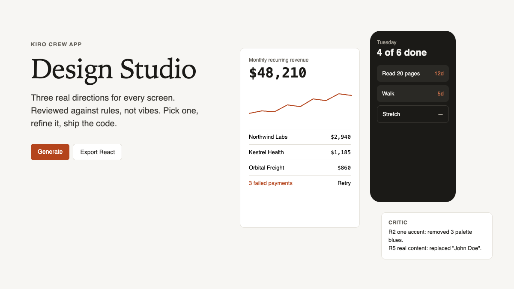
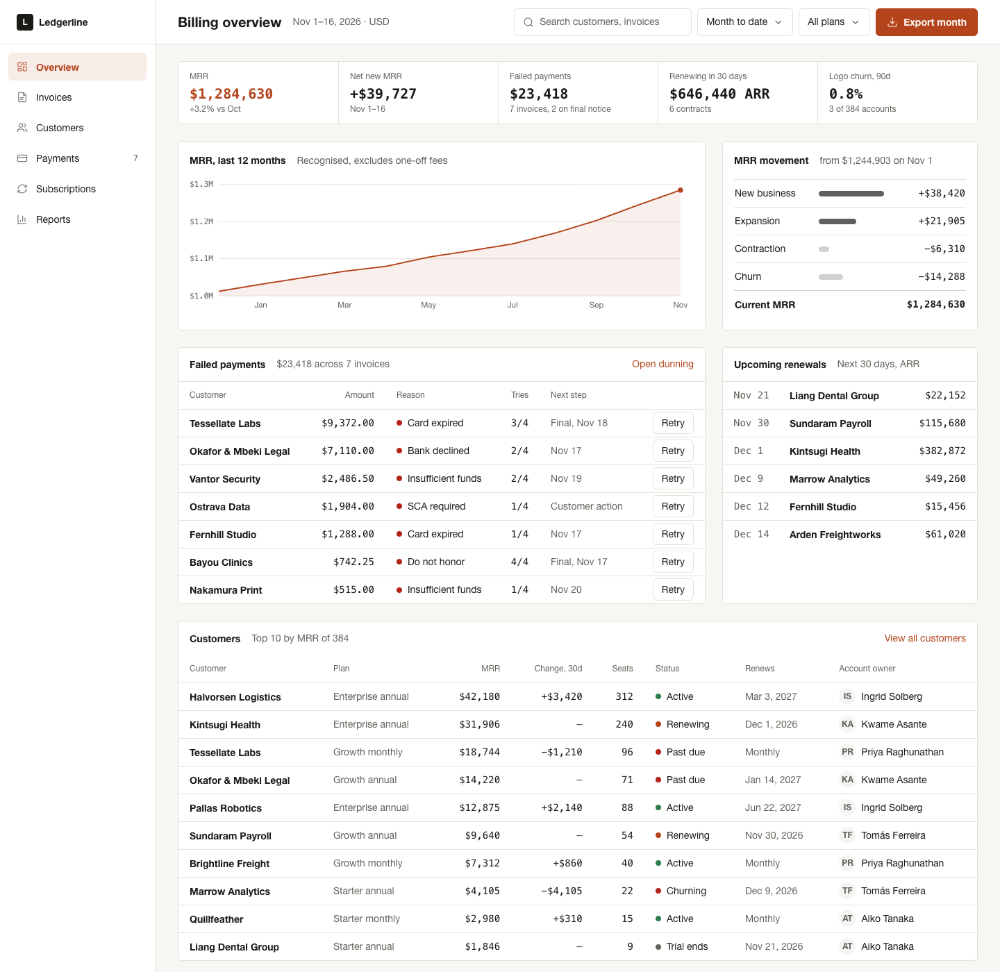
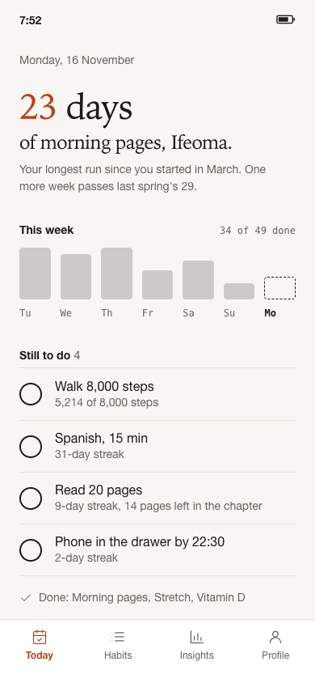
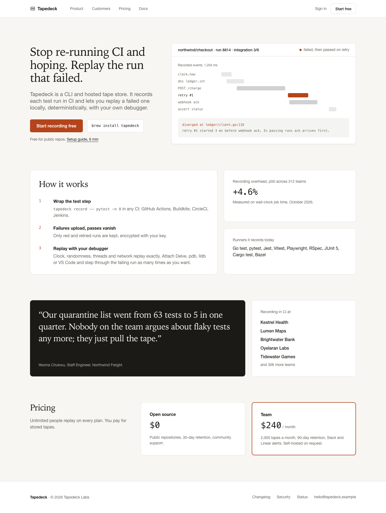

# Design Studio

<picture>
  <source media="(prefers-color-scheme: dark)" srcset="assets/hero.png">
  
</picture>

**Describe a screen. Get three real design directions, checked against rules.**

Design Studio is an app for [Kiro Crew](https://github.com/kirodotdev/KiroCrew),
the open-source personal AI agent.

## What it is

Design Studio adds a **Design Studio** page to the sidebar and three agents:
a designer, a critic and an exporter. You describe an app screen in plain
words; the designer draws three or four different versions, and the critic
checks each one against a list of design rules, fixes what breaks them and
marks it **Reviewed**. You pick one, ask for changes in your own words, and
take it away as HTML, a PNG picture or a React component.

**Get started:** Open **Apps → Library**, choose **Design Studio**, then
**Trust this app and enable**. Details in [Install](#install).

## The problem it solves

You write code every day, but your screens look either plain or "AI-made":
a purple-to-blue gradient, everything centred, emoji for icons, frosted
cards, "John Doe" in every table. You can tell something is off but not what.

Design Studio turns good-design habits into rules a machine can check (one
accent colour, a real type scale, spacing on a grid, real-looking content,
enough contrast) and makes a second agent hold the first one to them before
you see the result. It makes app screens only; pictures, icons and
illustrations are not part of it yet.

## Top 3 use cases

### 1. Get a first screen when you do not know where to start

You are building a billing dashboard for finance teams and have no idea what
it should look like. You type what the screen is for, choose **Generate**,
and get three different takes: a dense table-first ledger, a story-first
monthly brief, and a screen built around failed payments.



### 2. Design for a phone

You need the home screen of a habit tracker. Make the project a **Mobile app**
and the designer draws at phone size: here the streak is the headline,
followed by the week and the habits still to do.



### 3. A landing page, then the code

You need a landing page for a developer tool. Pick the version you like,
choose **Export React + Tailwind**, and copy a ready component into your
project.



<sub>These three pictures are real outputs of the app's agents and tools
(see [examples/](examples/)), not pictures of the Design Studio page itself.</sub>

## Watch it

A walkthrough recording has not been made yet: it needs the app installed in a
real Kiro Crew (see [Re-capture the README media](#re-capture-the-readme-media)).

## Install

**From the Kiro Crew App Store**

1. In Kiro Crew, open **Apps → Discover** in the left sidebar.
2. Search for **Design Studio** and choose **Install**.
3. Kiro Crew asks **Trust “Design Studio” to run its own code?** The app needs
   its own code to store your projects and to take screenshots of designs.
   Trusting it gives that code the same access Kiro Crew has (your files, your
   saved sign-ins and the internet), as the dialog says. Choose **Trust this
   app**. You can take it back later in **Settings → Security → Third-party
   apps**.
4. The app installs switched off. Choose **Enable** on its page. It then shows
   up under **Apps** in the sidebar and in **Apps → Library**.

It runs on Mac and Linux. Kiro Crew must already be able to chat: if ordinary
chats work, this works. For screenshots and **Download PNG** you need Google
Chrome or Chromium on the same computer; without it, everything else works.
No accounts or keys.

## First run

The page is empty, with a **New project** box on the left. Type a name, pick
what kind of app it is (**Dashboard**, **Mobile app**, **Marketing page**,
**Content / docs** or **Form / flow**) and choose **Create**. The kind sets how
dense and how large things are drawn.

## How to use it

1. Under **Describe the screen**, write what the screen is for and who uses it.
   Choose 3 or 4 **Variants** and **Generate**.
2. Cards appear as the designer finishes each one. The line above them says
   **Designer is working**, then **Critic is reviewing**, then **Ready**. Each
   card shows **Draft** or **Reviewed** and how many rule problems are left.
   Keep the page open until the round says **Critic is reviewing**: the page
   is what hands the round to the critic.
3. Choose **Pick this one** on the card you like. You see it large, with a
   **Desktop** / **Mobile** switch, the rule check and the critic's notes.
4. To change it, write what should change under **Refine**, choose how many
   **Takes**, and choose **Refine**. A new round appears on the main page.
5. To take it away: **Copy HTML**, **Download HTML**, **Download PNG**, or
   **Export React + Tailwind** (the code appears below with **Copy code**).
6. To change colours, fonts, corners or spacing for every screen in the
   project, open the **Design system** tab, change them and **Save design
   system**. The **Contrast** list turns red when text would be hard to read.

To see what an agent is doing, use **Designer chat** or **Critic chat** at the
top of a project.

## Settings & data

- **Where your data lives:** `~/.kiro/crew/apps/design-studio/data/projects/`
  (or under `$KIROCREW_HOME` if you set it). One folder per project.
- **What leaves your computer:** only what your Kiro Crew chats already send to
  its AI model (your prompt and the designs). Previews and screenshots load no
  web fonts, images or scripts from the internet.
- **Turn it off:** **Apps → Library**, open the **⋯** menu on Design Studio,
  choose **Disable**. Your data is kept.
- **Remove it:** the same menu, **Uninstall**. **Keep app data** is ticked by
  default; untick it to delete the data too.

## Troubleshooting / FAQ

**The page says "No Chrome or Chromium found".**
Install Google Chrome. Until then the critic cannot look at screenshots
(it still runs the rule check) and **Download PNG** does not work.

**The round has said "Designer is working" for a long time.**
Choose **Designer chat** to see what it is doing. It may be waiting for you to
allow one of its tools; allow it there.

**The round is stuck on "Critic is reviewing".**
Choose **Critic chat**. If the critic never got the round (for example the page
was closed at that moment), ask it there to review that round.

**Download PNG says "Chrome could not render".**
Close and reopen the variant and try again. If it keeps failing, Chrome may be
blocked from starting on this computer; use **Download HTML** and take a
screenshot in your browser.

## Development

### Install from a clone

```bash
cd ui && npm install && npm run build && cd ..
kirocrew app install /absolute/path/to/kirocrew-app-design-studio
```

`kirocrew app enable design-studio` is refused with `app_execution_denied`
until the app is trusted, and there is no command-line trust step. Enable it
from **Apps → Library** instead: that opens the trust dialog, and **Trust this
app and enable** does both. `kirocrew app disable design-studio` turns it off;
`kirocrew app uninstall design-studio` keeps the data and adding
`--purge-data` deletes it.

Layout and design decisions are in [docs/SPEC.md](docs/SPEC.md). Call one
agent tool without Kiro Crew:
`DESIGN_STUDIO_DATA=/tmp/ds python3 tools/mcp_call.py list_projects - <<< '{}'`.

### Tests

```bash
python -m pip install -r tests/requirements.txt
python -m pytest                      # DS_RENDER_TEST=1 also renders with Chrome
```

### Re-capture the README media

The pictures and the recording come from a real, isolated Kiro Crew gateway
driven by [`capture/`](capture/README.md). After any change to what the app shows:

```bash
python capture/capture.py --kirocrew /path/to/KiroCrew
python capture/check_readme.py
```

Then look at every image and at a few frames of the video before committing
(see [CHECKLIST.md](CHECKLIST.md)).

## License

Apache License 2.0. See [LICENSE](LICENSE) and [NOTICE](NOTICE). Bundles
Tailwind CSS (MIT); see NOTICE.
